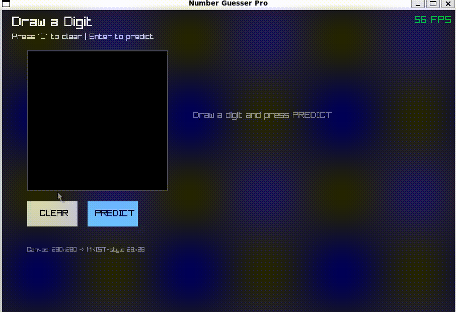
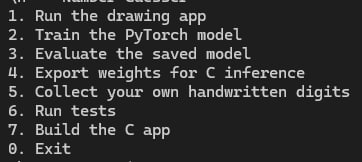

# Number Guesser

A desktop handwritten-digit recognition app built with **PyTorch, C, and Raylib**. Draw a digit, run it through a convolutional neural network (CNN), and see the prediction.

> **Project status:** the source code and developer workflow are available. A tested, ready-to-run desktop release is not published yet, so the current setup instructions are for building from source.

## Demo

<!-- TODO: Add assets/demo.gif (recommended: 800 px wide, short, optimized).
     Record the real app: draw a digit -> click predict -> show the result.
     If you also keep a higher-quality video, save it as assets/demo.mp4 and link it below. -->

<p align="center">
  
</p>

<p align="center">
  <em>Demo to add: draw a digit, submit it, and show the model's prediction.</em>
</p>

<!-- Optional full video link once assets/demo.mp4 exists:
[Watch the full demo video](assets/demo.mp4)
-->

## What the demo shows

The user draws a handwritten digit in the app, asks the model to predict it, and sees the predicted class. The desktop app performs inference through the project's native C implementation; PyTorch is used for training and exporting the model, not for predictions inside the C app.

## Screenshot

<!-- TODO: Add assets/screenshot.png, a clear screenshot of the real app.
     Include the drawing canvas, the digit you drew, and the prediction/result area.
     Replace this placeholder with the real screenshot after adding the file. -->

<p align="center">
  
</p>

<p align="center">
  <em>Screenshot to add: show the app window clearly, with a digit on the canvas and its prediction visible.</em>
</p>

## How it works

1. **Train:** Python and PyTorch train a CNN on the MNIST handwritten-digit dataset.
2. **Export:** the trained model's weights are written to a binary file that the C program can load.
3. **Predict:** the desktop app passes the drawn digit through the native C inference engine and displays the result.
4. **Verify:** C unit tests and a Python/C numerical parity test compare selected computations between the two implementations.

This project combines machine learning with systems programming: Python handles model training, while C runs inference in the desktop app.

## Features

- Draw handwritten digits in a Raylib desktop application.
- Recognize digits with a CNN trained on MNIST.
- Run inference in native C without using PyTorch in the prediction path.
- Train, evaluate, and export the model with Python scripts.
- Compare selected Python and C intermediate values with a numerical parity test.
- Collect handwritten digit samples using the digit-collection tool.

## Tech stack

- **Python / PyTorch** — dataset handling, training, evaluation, and weight export.
- **C** — model loading and neural-network inference.
- **Raylib** — desktop drawing interface.
- **CMake** — configure and build the C application and tests.
- **Make** — optional shortcuts for development commands.
- **CTest / GitHub Actions** — automated checks.

## Download and run

### Want to use the app without setting up a development environment?

A packaged desktop download is **not available yet**. The repository currently does not include a verified release that bundles the executable, model weights, and required runtime files. Check the [Releases page](https://github.com/sahandkhodayi/Number-Guesser/releases) for future builds.

### Build from source

Building from source requires Python, PyTorch, a C compiler, CMake, and Raylib for the GUI. The steps below are for contributors and developers—not a one-click end-user installation.

#### Requirements

- Python 3.10–3.12 recommended.
- A working PyTorch installation.
- CMake 3.20 or newer.
- A C compiler supported by CMake.
- Raylib installed and discoverable by CMake to build the GUI.
- GNU Make only if you want to use the `make` shortcuts.

#### 1. Get the source

```bash
git clone https://github.com/sahandkhodayi/Number-Guesser.git
cd Number-Guesser
```

Or download the repository ZIP from GitHub and extract it.

#### 2. Install Python dependencies

**Windows PowerShell**

```powershell
py -3.12 -m venv .venv
.venv\Scripts\Activate.ps1
python -m pip install --upgrade pip
python -m pip install -r requirements.txt
```

**Linux / WSL**

```bash
python3 -m venv .venv
source .venv/bin/activate
python -m pip install --upgrade pip
python -m pip install -r requirements.txt
```

If PyTorch installation fails, choose the appropriate command for your operating system and hardware from the [official PyTorch installation page](https://pytorch.org/get-started/locally/).

#### 3. Train and export the model

A fresh clone does not include the generated model weights because model artifacts are excluded from Git. From the repository root, run:

```bash
python python/train.py
python python/export.py
```

Training downloads/uses the MNIST dataset and may take a while. If you train a new checkpoint later, export the weights again before running the C app.

#### 4. Build the desktop app

Install Raylib first. Then, from the repository root:

```bash
cmake -S . -B build -DBUILD_GUI=ON
cmake --build build --config Release
```

Run the generated `number_guesser` executable with `build/` as its working directory because the app currently resolves `../models/weights.bin` relative to the working directory. With multi-configuration generators, the executable may be inside `build/Release/` on Windows.

Alternatively, launch the interactive project menu:

```bash
python main.py
```

The menu can train, evaluate, export, collect digit samples, build the app, and run tests. These options require their corresponding dependencies to be installed.

## Development commands

| Command | Purpose |
|---|---|
| `make menu` | Open the interactive project menu |
| `make train` | Train and save the PyTorch model |
| `make evaluate` | Evaluate the saved checkpoint without training |
| `make export` | Export checkpoint weights for C inference |
| `make collect` | Collect handwritten digit samples |
| `make build` | Configure and build the desktop app |
| `make test` | Run headless C unit tests and Python/C parity checks |
| `make parity` | Run the Python/C numerical parity test |
| `make clean` | Remove generated build artifacts |

GNU Make may not be installed on Windows by default. You can use WSL, install Make, or run the equivalent Python and CMake commands directly.

## Project structure

| Path | Purpose |
|---|---|
| `python/` | Model, training, evaluation, data helpers, and export |
| `c/include/`, `c/src/` | C inference engine and Raylib UI |
| `tests/` | C unit tests and Python/C parity test |
| `benchmark/` | Inputs and outputs used for numerical comparison |
| `models/` | Generated model checkpoints and exported weights |
| `main.py` | Interactive project menu |
| `CMakeLists.txt`, `Makefile` | Build configuration and development shortcuts |

## Tests and documentation

The repository includes C unit tests, a Python/C numerical parity test, and a GitHub Actions workflow. These checks cover configured test cases; they do not guarantee correct predictions for every handwriting style or prove that the GUI works on every machine.

- [Architecture](docs/ARCHITECTURE.md)
- [Development setup](docs/DEVELOPMENT.md)
- [Testing](docs/TESTING.md)
- [Model and data](docs/MODEL_AND_DATA.md)
- [Docker and CI](docs/DOCKER_AND_CI.md)
- [Full project guide](fullguide.md)
- [Workflow guide](workflow-guide.md)

## Docker

Docker is an optional tool for developers and automated testing. The current image is intended for headless C tests; it does **not** run the Raylib desktop GUI. End users should not need Docker to use a future packaged desktop release.

## Roadmap

- [ ] Add the real demo GIF and application screenshot.
- [ ] Verify a clean build on supported platforms.
- [ ] Package and test a ready-to-run Windows build with the required model weights and runtime files.
- [ ] Package and test a ready-to-run Linux build.
- [ ] Publish a release with clear download and launch instructions.

---

Made as a learning project exploring neural networks, computer vision, C, and running a trained model outside its original Python framework.
